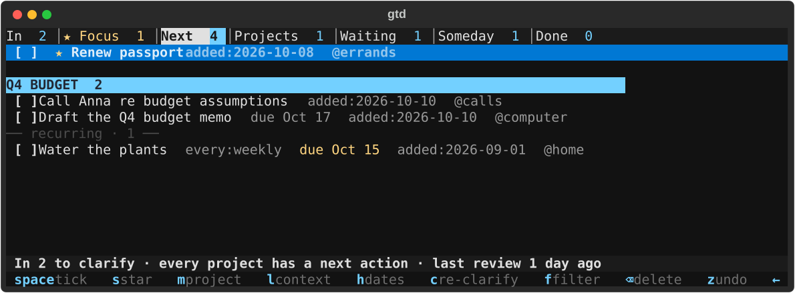

# bandwagon

**bandwagon keeps your tasks in one plain markdown file per area of your life and runs David Allen's *Getting Things Done* over it from the terminal.** The command is `gtd`. With no arguments it opens the app. With a command it is a scripting CLI, and both read and write the same file. The file holds `- [ ]` lines under six `##` headings and nothing else. Any editor can read it, and an Obsidian vault takes it unchanged.



## Install

**One command installs it on macOS or Linux.** It needs [uv](https://docs.astral.sh/uv/), which fetches Python 3.11 or newer when the machine has none.

```sh
curl -LsSf https://astral.sh/uv/install.sh | sh        # only if you don't have uv
uv tool install git+https://github.com/forcingfx/bandwagon
gtd --version
```

`uv tool upgrade bandwagon` moves to the latest release. `@v0.1.0` on the install line pins one.

## The first run

**`gtd` opens on the Files screen the first time, because nothing is configured yet.** `n` creates a task file. The default path is `gtd.md` in the current folder: run it inside your notes folder and the file stays there. `a` adds a file you already have. `F` brings the screen back at any time to add, move, rename or remove an area.

- **The app looks at every file before it loads it, and writes nothing until you say so.** A gtd file, or a path that does not exist yet, goes straight in. A plain markdown file is offered for adoption: the six lists are appended and its own lines stay where they are. A file with stray lines inside the lists, or with lists the app does not know, says so and keeps them. A file written by a newer gtd, or one that cannot be read, is refused.
- **`gtd init PATH [--area NAME]` does the same from a script,** with no prompts.
- **`gtd --file PATH` works on one file with no config at all.**

**Each area is one file, and the app shows the areas side by side.** The config is `~/.config/gtd/config.toml`, or the path in `$GTD_CONFIG`. The Files screen writes it. This is the whole format:

```toml
# gtd config. One [areas.NAME] per task file; the app shows them side by side.
capture = "work"                 # where captures land when every area is showing
contexts = ["@calls", "@computer", "@office", "@home", "@errands", "@agendas"]   # offered in clarify, in order

[areas.work]
file = "~/notes/work/gtd.md"
state_dir = "~/notes/work/.gtd"            # proposal counts, overflow, expired log (gtd propose, gtd expire)
proposal_cap = 5                           # automated proposals per day; omit for no cap
proposal_reserve = { process = 3 }         # slots of the cap kept for one caller (propose --caller)

[areas.home]
file = "~/notes/home/gtd.md"
completions_log = "~/notes/home/completions.md"   # a table of recurring and one-off ticks, appended to
```

## The file

**Each GTD list is one `##` section, because the book insists on hard edges between the categories, and a heading keeps that edge visible in any editor.** The sections are In, Next Actions, Projects, Waiting For, Someday/Maybe and Done. The header comment carries the format version, the date of the last weekly review and the prune setting.

```markdown
<!-- gtd v1 · last-review: 2026-10-13 -->

## In
- [ ] Call Anna re Q4 budget @calls +budget due:2026-10-17 added:2026-10-13
## Next Actions
## Projects
## Waiting For
## Someday/Maybe
## Done
```

- **Each item is one `- [ ]` line with its tags at the end.** The tags are `@context`, `+project`, `waiting:who`, `every:weekly`, `start:`, `due:`, `added:`, `done:`, `star:` and `src:`, which records where an automated proposal came from. An item can carry several contexts side by side. The parser reads tags only from the end of a line, which means an `@` in the middle of a sentence stays text.
- **A line the app cannot read is kept exactly as written,** and so is any `##` section it does not know. A hand edit is never destroyed.
- **Links go in the task text in markdown's own forms.** `[label](url)` links anything, and `[[note|label]]` links a note beside the file, which is Obsidian's wikilink. `o` opens a link from the app, with `open` on macOS and `xdg-open` on Linux. When opening fails the link goes to the clipboard instead, through `pbcopy` on macOS and `wl-copy`, `xclip` or `xsel` on Linux. Under Sway, an Obsidian note is also pulled to the current workspace.
- **Done items older than 14 days are dropped on write,** unless the header says `prune: manual`.
- **Every change re-reads the file first and writes through an atomic rename,** under a lock that the app, the CLI and any timer share. An edit from an editor or a sync client that arrives while the app is open is merged into the next write, and it appears in the app on its own within a second.

## The app

**`?` shows every key, and `/` searches tasks and commands in one box.** Every pop-up answers to a number, and `Esc` goes back one step with nothing written.

- **`a` captures.** `Enter` saves and closes. `Tab` saves and clears the box for the next item.
- **`c` clarifies, walking In to empty through Allen's questions on one card:** what is it, what is the next action, which project, and whether to defer, delegate or do it now, then a context and dates. `c` on any item re-opens the card prefilled, which is how an item moves between lists. `m`, `l`, `h` and `p` open the card on one row: project, context, dates, waiting for.
- **The lists are where you organize.** `Space` ticks, `e` edits the text, `⌫` deletes, `x` marks rows for one bulk delete, and `z` undoes any of these one step per press. `Enter` on a project opens its page.
- **`w` runs the weekly review as a guided tour of the lists in the book's order.** The status line shows the step and what to do in it. `n` moves on, and the last `n` records the review date.
- **`f` filters Next Actions by context.** Next Actions groups one-off tasks by project with unassigned tasks first, and recurring tasks sit in their own block.
- **`s` stars an item for Focus.** Focus is a tab after In that lists every starred item across every area until it is done or unstarred. `d` shows or hides deferred tasks, whose start date is still ahead.
- **`v` cycles the areas, `L` edits the contexts and `F` edits the files.** The Project and Context rows are search boxes: type to narrow, `Enter` takes, and the last row creates a new entry from the words typed.

## The command line

**`gtd --help` lists every command with examples, and `gtd help COMMAND` shows one.** In a terminal, `done` and `find` open a picker over the matches. From a script they print or refuse and never prompt.

```sh
gtd add "Call Anna re Q4 budget" --context calls --due fri
gtd done "Q4 budget"
gtd find passport
gtd list --area home --section next     # JSON
```

**Scripts never edit the file by hand.** Every write goes through these commands, which means one parser and one lock handle every change the same way.

- **`gtd propose "text" --src LINK` suggests a task to In and records where it came from.** The area's `proposal_cap` limits proposals per day, and extras are parked in `task-overflow.md` under its `state_dir`. `proposal_reserve` keeps slots of the cap for a named caller, and a caller names itself with `--caller NAME` or `$GTD_CALLER`.
- **`gtd expire` drops proposals left unsorted in In for seven days, and `gtd sweep` files checkboxes ticked in the file itself.** Both are meant for a timer.

## Development

```sh
git clone https://github.com/forcingfx/bandwagon && cd bandwagon
uv sync
uv run gtd
uv run ruff check .
uv run pytest            # about two minutes; most tests drive the app headlessly
```

**`model.py` holds the GTD rules as pure functions, `store.py` reads and writes the file, `app.py` is the Textual UI, `cli.py` is the scripting surface, and `config.py` reads the areas.** CI runs the linter and the tests on Linux and macOS, on Python 3.11 and 3.14. [CONTRIBUTING.md](CONTRIBUTING.md) has the commit convention and the release recipe.

## License

[MIT](LICENSE).
